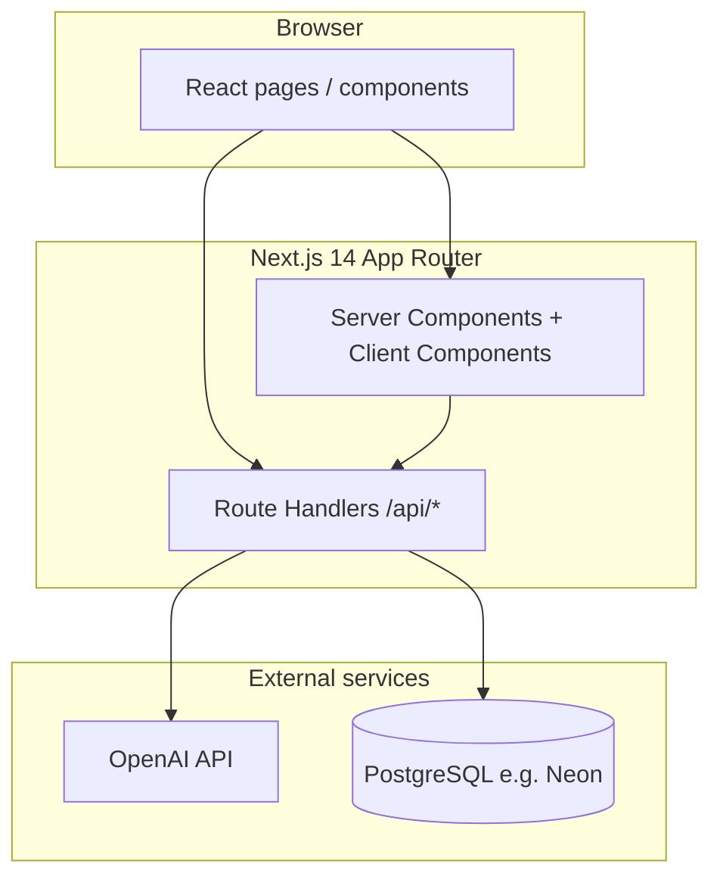

# Clause AI — Everything Document

This is the **single reference** for the Clause project: what it is in plain language, how it works technically, where each piece lives in the repo, and how to run and ship it. It is written so both **non-technical readers** and **developers** can use the same file.

**Package name:** `clause-ai` (npm)  
**Product name:** Clause AI — Contract Intelligence Platform  
**Repository root:** Next.js 14 monolith (App Router), TypeScript, Prisma, PostgreSQL.

---

## Part 1 — For everyone (what this is)

### 1.1 Plain-language summary

Clause AI is a **web application** that helps people work with **contracts** (agreements, NDAs, service terms, and similar documents). You can:

- **Upload** a contract file (PDF, Word, text, etc.).
- Have the system **extract text**, split it into **clauses**, and **store** everything securely per user.
- Run **AI-assisted reviews**: risk and strength scores, loophole-style findings, fairness views, ethics/bias scanning, adversarial “what would the other side argue?” exercises, clause rewrites in different styles, and benchmarks against typical expectations.
- Use **templates** to generate draft agreements by filling in fields (e.g. party names, dates).
- See **dashboards and analytics** (charts, stats) built from stored data.

**Important:** The product uses AI to **assist** review; it is **not** a substitute for a qualified lawyer. Outputs are probabilistic and must be verified by humans, especially for regulated or high-stakes matters.

### 1.2 Who uses it

- **Legal / compliance teams** prototyping review and consistency checks.
- **Founders / operators** getting a structured first pass on vendor or customer paper.
- **Admins** managing users (via database seed and settings patterns in the app).

### 1.3 What “success” looks like for a user

1. Sign in.  
2. Upload or work from templates.  
3. See clauses, scores, and AI-generated explanations and suggestions.  
4. Optionally rewrite clauses or run stress tests on specific clauses.  
5. Search across their own contracts and clauses.

---

## Part 2 — Product surface (screens and areas)

| Area (route) | Purpose |
|----------------|---------|
| `/` | Public landing page: value proposition and sign-in links. |
| `/login` | Credentials sign-in (NextAuth). |
| `/dashboard` | Logged-in home / overview. |
| `/contracts` | List and manage contracts. |
| `/contracts/upload` | Upload flow for new documents. |
| `/contracts/[id]` | Single contract detail and downstream actions. |
| `/analysis` | Analysis hub for contract-level insights. |
| `/drafting` | AI-assisted drafting experience. |
| `/templates` | Browse and use contract templates. |
| `/analytics` | Charts and reporting (Recharts). |
| `/settings` | User preferences and profile-related UI. |

Authenticated app chrome lives under `app/(dashboard)/`, wrapped by `DashboardLayout` (sidebar, header, providers).

---

## Part 3 — Technical architecture

### 3.1 High-level diagram

**In one sentence:** The browser talks to **Next.js**, which reads/writes **Postgres via Prisma** and calls **OpenAI** for language tasks (analysis, rewrite, embeddings helper).

### 3.2 Stack (authoritative from `package.json`)

| Concern | Technology |
|--------|------------|
| Framework | Next.js **14.2** (App Router) |
| UI | React **18**, TypeScript **5.5** |
| Styling | Tailwind CSS **3.4**, `tailwindcss-animate`, `tailwind-merge`, `clsx`, `class-variance-authority` |
| Components | Radix UI primitives + local `components/ui/*` (shadcn-style pattern) |
| Motion | Framer Motion **11** |
| Icons | Lucide React |
| Charts | Recharts **2.12** |
| Auth | **NextAuth.js 4** (Credentials provider, JWT sessions) |
| Password hashing | bcryptjs |
| Database | **PostgreSQL** (designed for Neon; any Postgres works if URL is valid) |
| ORM | **Prisma 6** |
| AI SDK | **OpenAI** official Node client **4.x** |
| Documents | **pdf-parse** (PDF), **mammoth** (DOCX); TXT/MD/RTF handled in code |
| Validation / shapes | Zod **3.23** |

### 3.3 Important runtime details

- **`pdf-parse` and `mammoth`** are listed in `next.config.js` under `experimental.serverComponentsExternalPackages` so they bundle correctly on the server.
- **Webpack aliases** set `canvas` and `encoding` to `false` to avoid optional native dependency issues from the PDF stack.
- **Path alias:** `@/*` maps to the repository root (`tsconfig.json`).

### 3.4 Where “business logic” lives

| Folder | Role |
|--------|------|
| `app/` | Routes: UI pages and `app/api/**/route.ts` HTTP handlers. |
| `lib/` | Auth config, Prisma singleton, OpenAI singleton, parsing pipeline, small utilities. |
| `ai/` | Prompts (`prompts.ts`), analysis orchestration (`analysis.ts`), embedding helper (`embeddings.ts`). |
| `config/` | Static config such as `jurisdictions.ts`; `users.json` exists for documented patterns (primary users are DB-backed). |
| `components/` | Reusable UI and layout (`dashboard-layout`, sidebar, shadcn-style primitives). |
| `prisma/` | `schema.prisma`, migrations (if present), `seed.ts`, optional one-off scripts. |
| `types/` | Type augmentation (e.g. NextAuth session fields). |

---

## Part 4 — Data model (Prisma / Postgres)

All persistent entities are defined in `prisma/schema.prisma`. Table names use `@@map` (e.g. `users`, `contracts`).

### 4.1 Entity list (technical → normal)

| Model | Technical | Plain English |
|-------|-----------|----------------|
| `User` | `cuid` id, unique email, `passwordHash`, `role` (`admin` \| `user`), optional `image`, `jurisdiction` default `US` | A person who can log in; admins have elevated role in app logic. |
| `Contract` | Belongs to `User`; stores `rawText`, `cleanedText`, `fileName`, `fileType`, optional `fileUrl`, status, scores, summary | One uploaded agreement and its extracted text + high-level metrics. |
| `Clause` | Belongs to `Contract`; `clauseNumber`, text, optional scores, `analysisJson`, `category` | One section or numbered block inside a contract. |
| `ClauseVersion` | History rows per clause: version number, text, optional scores, `changeReason` | Audit trail when clause text changes. |
| `AnalysisResult` | Per contract + user; `analysisType` string; `resultJson`; optional scores | Stored output of a specific analysis run (loophole, fairness, etc.). |
| `StressTest` | Per clause; attack scenarios JSON, litigation metrics | Result of adversarial stress testing on one clause. |
| `Template` | Reusable document body + `fields` JSON, category, jurisdiction | A blueprint used to generate documents from user answers. |
| `RiskProfile` | One per user (unique `userId`); tolerance, industry, optional JSON preferences | User-level preferences for risk posture / voice. |
| `Webhook` | URL, event list, secret — **schema exists**; integration depth depends on app usage | Placeholder / future integration for outbound notifications. |

### 4.2 Relationship rules

- Deleting a **User** cascades to their **Contracts** and related rows per schema `onDelete: Cascade` where defined.
- **Contracts** own **Clauses**; **Clauses** own **Versions** and **StressTests**.

---

## Part 5 — Authentication and sessions

### 5.1 How login works (technical)

- **Provider:** NextAuth **Credentials** only (`lib/auth.ts`).
- **Verification:** Email looked up in `User` table; password checked with `bcrypt.compare` against `passwordHash`.
- **Session strategy:** **JWT** (not database sessions). Session max age **30 days**.
- **Custom pages:** `signIn: "/login"`.
- **Callbacks:** User `id` and `role` are copied into JWT and then into `session.user` (see `types/next-auth.d.ts` for typings).

### 5.2 Same thing, simply

Users sign in with **email and password** stored in your **Postgres** database. The server signs a **token** so the browser stays logged in for a while without storing passwords in the token.

### 5.3 Default users (development)

Created by `prisma/seed.ts` (hashed passwords):

| Email | Password | Role |
|-------|----------|------|
| `admin@clauseai.com` | `admin123` | admin |
| `user@clauseai.com` | `password` | user |

**Production:** Replace or remove these accounts; never ship known passwords.

---

## Part 6 — Document pipeline (upload → text → clauses)

### 6.1 Supported files

From `lib/parsing.ts` and upload validation: **pdf, docx, txt, rtf, md**.

### 6.2 Steps

1. **Binary in:** File read as `Buffer` on the server.  
2. **Format-specific extract:** PDF via dynamic `import("pdf-parse")`, DOCX via `mammoth.extractRawText`, plain text from UTF-8, RTF via regex stripping.  
3. **Clean:** `cleanText()` normalizes newlines, trims lines, removes common page-number / header/footer noise.  
4. **Split into clauses:** Heuristics using section patterns (Article/Section/Clause numbering, etc.).  
5. **Categorize:** Keyword map (Payment, Termination, Liability, …) assigns a best-effort `category`.  
6. **Persist:** `POST /api/contracts` parses then creates `Contract` + many `Clause` rows (see route implementation).

### 6.3 Limits

- **Upload preview** (`/api/upload`): max **10 MB**; returns parsed text preview (first ~2000 chars of cleaned text) and clause count **without** persisting a contract (until the contracts API is used accordingly).

---

## Part 7 — AI layer

### 7.1 Configuration

- **Client:** `lib/openai.ts` — singleton `OpenAI` using `process.env.OPENAI_API_KEY`.
- **Model:** `AI_MODEL` env var, default **`gpt-4o-mini`**.
- **Embeddings helper:** `ai/embeddings.ts` uses **`text-embedding-3-small`**, truncating input to **8000** characters. Includes `cosineSimilarity` for vector comparison **in code**.

### 7.2 Prompts and structured outputs

- **`ai/prompts.ts`** — system prompts and enums (e.g. rewrite styles, summary view types).
- **`ai/analysis.ts`** — TypeScript interfaces for analysis shapes (loopholes, fairness, stress test, rewrite, ethics, etc.) and functions that call OpenAI chat completions using those prompts.

### 7.3 Non-technical explanation

The app sends **selected contract or clause text** and **instructions** to OpenAI. The model returns **JSON-like structured answers** (scores, lists of issues, suggested wording). The app **stores** some of those results on contracts, clauses, or `AnalysisResult` rows depending on the endpoint.

### 7.4 Honest note on “semantic search”

- **`ai/embeddings.ts`** exists and can produce embeddings for text.
- **`app/api/search/route.ts`** currently implements **case-insensitive substring search** in Postgres (`contains`) across contracts and clauses. The file itself contains a **TODO** to replace this with true vector/embedding search.  
So: **product messaging may say “semantic search”**; **current implementation is primarily lexical unless you extend it.**

---

## Part 8 — HTTP API (Route Handlers)

Unless noted, routes expect a **logged-in session** (401 if missing).

| Method | Path | Role |
|--------|------|------|
| * | `/api/auth/[...nextauth]` | NextAuth endpoints. |
| POST | `/api/upload` | Parse file only; returns text preview + clause count. |
| GET, POST | `/api/contracts` | List contracts (pagination, filters); **POST** creates contract from uploaded file (parse + DB). |
| GET, PATCH, DELETE | `/api/contracts/[id]` | Single contract CRUD-style access. |
| POST | `/api/contracts/[id]/analyze` | Run contract-level AI analysis pipeline; persists results. |
| GET, PATCH, DELETE | `/api/clauses/[id]` | Clause fetch/update/delete. |
| POST | `/api/clauses/[id]/stress-test` | Adversarial stress test for one clause. |
| POST | `/api/clauses/[id]/benchmark` | Clause benchmarking / scoring. |
| POST | `/api/clauses/[id]/rewrite` | Rewrite one clause with style instructions. |
| POST | `/api/clauses/rewrite` | Bulk or alternate rewrite entry (see implementation). |
| GET, POST | `/api/templates` | List / create templates. |
| GET, PATCH, DELETE | `/api/templates/[id]` | Template by id. |
| POST | `/api/templates/[id]/generate` | Fill template fields → generated document text. |
| POST | `/api/analysis/ethics` | Ethics / bias style scan. |
| GET | `/api/dashboard/stats` | Aggregated stats for dashboard widgets. |
| POST | `/api/search` | Search contracts + clauses for current user. |

Many handlers include a **`// TODO: Add rate limiting middleware`** comment — **rate limiting is not implemented** in-repo as of this document.

---

## Part 9 — Jurisdiction configuration

`config/jurisdictions.ts` defines metadata for **US**, **IN** (India), and **UK**: legal system name, terminology map, and compliance notes. This is used to **steer language and disclaimers** in prompts/UI, not to guarantee legal compliance by itself.

---

## Part 10 — Environment variables

From `.env.example`:

| Variable | Required | Purpose |
|----------|----------|---------|
| `DATABASE_URL` | Yes | Postgres connection string (SSL typical for Neon: `?sslmode=require`). |
| `NEXTAUTH_SECRET` | Yes | Secret for signing JWT/session material. |
| `NEXTAUTH_URL` | Yes | Canonical app URL (local vs production). |
| `OPENAI_API_KEY` | Yes for AI features | OpenAI API access. |
| `AI_MODEL` | No | Override chat model (default `gpt-4o-mini`). |
| `BLOB_READ_WRITE_TOKEN` | No | For Vercel Blob if you add file storage to match README optional section. |

Never commit `.env`. `.env.example` is the template for teammates and CI secrets naming.

---

## Part 11 — Scripts and database commands

From `package.json`:

| Script | Command | Meaning |
|--------|---------|---------|
| `dev` | `next dev` | Local development server (default port 3000). |
| `build` | `next build` | Production build. |
| `start` | `next start` | Run production server after build. |
| `lint` | `next lint` | ESLint. |
| `postinstall` | `prisma generate` | Generates Prisma Client after `npm install`. |
| `db:migrate` | `prisma migrate dev` | Dev migrations (creates migration files). |
| `db:push` | `prisma db push` | Push schema without migration history (prototyping). |
| `db:seed` | `tsx prisma/seed.ts` | Seed users, risk profiles, templates. |
| `db:studio` | `prisma studio` | Web UI for browsing DB. |

**Typical first-time setup:** `npm install` → configure `.env` → `npx prisma migrate dev` → `npm run db:seed` → `npm run dev`.

---

## Part 12 — CI/CD (GitHub Actions)

Workflow: `.github/workflows/deploy.yml` — **Clause AI CI/CD**.

| Job | When | What it does |
|-----|------|----------------|
| `lint-and-typecheck` | PR + push to `main` | checkout → Node 20 → `npm ci` → `prisma generate` → `npm run lint` → `npx tsc --noEmit` |
| `build` | After lint passes | Same install + generate → `npm run build` with secrets: `DATABASE_URL`, `NEXTAUTH_SECRET`, `OPENAI_API_KEY` |
| `migrate` | Push to `main` only (not PRs) | After build → `npx prisma migrate deploy` with `DATABASE_URL` |

**GitHub repository secrets required:** `DATABASE_URL`, `NEXTAUTH_SECRET`, `OPENAI_API_KEY` (for build job as configured).

---

## Part 13 — Deployment (Vercel + Neon pattern)

1. **Neon (or any Postgres):** create database, copy `DATABASE_URL`.  
2. **Vercel:** import repo, set env vars to match `.env.example` + production `NEXTAUTH_URL`.  
3. **Migrations:** CI runs `migrate deploy` on main; alternatively add migrate step to Vercel build if you prefer (trade-offs: build time vs explicit CI).  
4. **OpenAI:** billing and key scoped for production usage; monitor spend.

---

## Part 14 — Security and operational hygiene

- **HTTPS** in production; **rotate** `NEXTAUTH_SECRET` if leaked.  
- **Password storage:** only bcrypt hashes in DB — good.  
- **File uploads:** size/type checks exist; still consider virus scanning and storage policy for sensitive legal docs.  
- **Rate limiting / abuse:** TODOs in code — plan before public launch.  
- **AI safety:** log retention, PII in prompts, and data residency are **your** operational choices; not fully encoded in this repo.

---

## Part 15 — Glossary

| Term | Meaning here |
|------|----------------|
| App Router | Next.js file-based routing under `app/`. |
| Route Handler | `route.ts` exporting HTTP methods for `/api/...`. |
| JWT session | Stateless signed session blob, not a DB session table. |
| Prisma | Type-safe ORM; schema is source of truth for tables. |
| Clause | A structured chunk of contract text with metadata. |
| Stress test | Simulated opposing arguments against a clause. |
| Embedding | Numeric vector representing text meaning; helper exists; search may not use it yet. |

---

## Part 16 — Related docs and files

- **`README.md`** — Extended setup guide (Neon, OpenAI, Vercel, troubleshooting, sample contract). Keep using it for step-by-step onboarding.  
- **`EVERYTHING.md` (this file)** — Consolidated map of the system as implemented.  
- **`prisma/schema.prisma`** — Authoritative database shape.  
- **`lib/parsing.ts`** — Authoritative parsing and clause-splitting behavior.

---

## Part 17 — Maintenance checklist for contributors

- [ ] After schema edits: run migrations and regenerate client (`prisma generate` runs on install).  
- [ ] After adding API routes: secure with `getServerSession`; avoid leaking other users’ `userId`.  
- [ ] When changing AI behavior: update `ai/prompts.ts` / `ai/analysis.ts` and test token usage.  
- [ ] Before production: remove default seed credentials or force password reset.  
- [ ] Align marketing copy with **actual** search implementation if you ship widely.

---

*End of Everything document. For day-to-step setup commands and troubleshooting tables, see `README.md`.*
